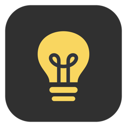
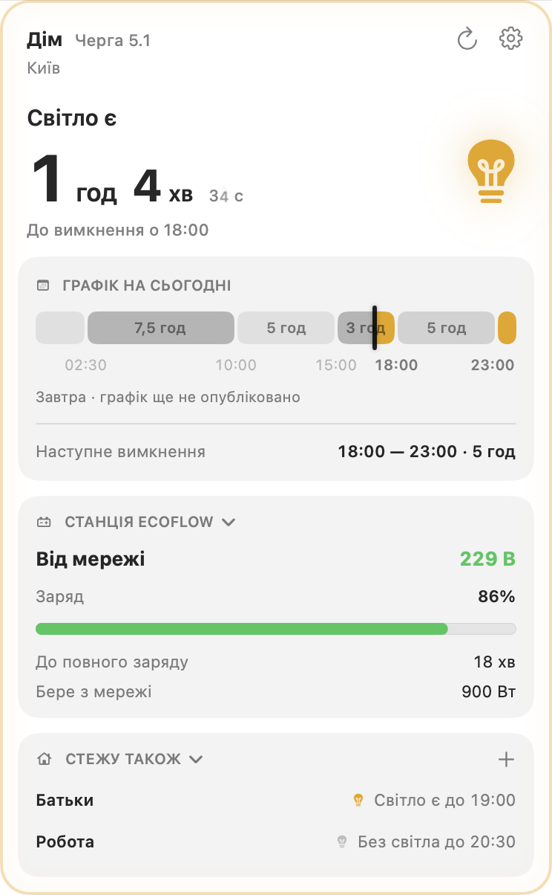
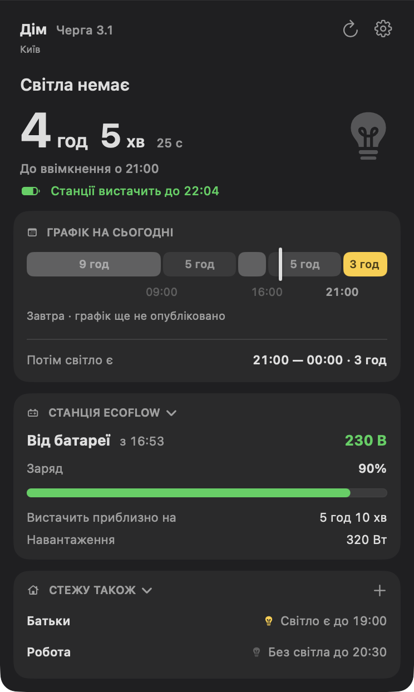

<div align="center">



# Світлик для Mac

Графік відключень світла в рядку меню Mac. Київ та Київська область.

<a href="https://github.com/DenK0-UA/Svitlyk-Mac/releases/latest/download/Svitlyk-macOS.zip"></a>

**Mac** з M1 і новішими, **macOS 26** і новіша

[Сайт](https://denk0-ua.github.io/Svitlyk-Mac/) · [Як встановити](https://denk0-ua.github.io/Svitlyk-Mac/#install) · [Усі версії та зміни](https://github.com/DenK0-UA/Svitlyk-Mac/releases) · [Зворотний зв’язок](https://t.me/DenK0_UA) · [Світлик для Windows](https://github.com/DenK0-UA/Svitlyk)

<br>

 &nbsp; 

<sub>Ліворуч — світло є, станція заряджається. Праворуч — світла немає, а під відліком видно, що станції вистачить до увімкнення. Адреси вигадані.</sub>

</div>

### Лампочка біля годинника

Світлик живе у верхньому рядку меню. Натисніть лампочку — відкриється панель із графіком вашого будинку, відліком до зміни світла й іншими адресами, за якими ви стежите. Перед вимкненням і ввімкненням Світлик нагадає.

**А якщо вдома є зарядна станція EcoFlow,** Світлик під'єднається до неї через Bluetooth і знатиме, чи світло справді є, а не лише що каже графік. Зникло світло — одразу повідомить, дали — теж. Покаже заряд, напругу в мережі, скільки зараз споживає квартира і на скільки ще вистачить станції. А під відліком покаже, чи вистачить станції до увімкнення світла, і якщо ні — при якому споживанні вистачить. Поки це працює з Delta 2 Max.

Нові версії Світлик пропонує сам: у панелі з'явиться кнопка «Оновити», і за кілька секунд усе готово.

### Як встановити

1. [Завантажте Світлик](https://github.com/DenK0-UA/Svitlyk-Mac/releases/latest/download/Svitlyk-macOS.zip) і відкрийте ZIP — поруч з'явиться Світлик.
2. Перетягніть **Svitlyk** у папку «Програми».
3. Відкрийте **Термінал** (`⌘ Пробіл`, введіть «Термінал») і вставте команду:

```bash
xattr -dr com.apple.quarantine "/Applications/Svitlyk.app" && open "/Applications/Svitlyk.app"
```

Світлик ще не має платного підпису Apple, тому macOS спершу не дає його відкрити. Команда знімає це обмеження лише зі Світлика й запускає його. Робити це треба один раз: нові версії Світлик встановить сам.

4. Виберіть свою адресу — і готово.

Докладніше, з картинками, — на [сайті](https://denk0-ua.github.io/Svitlyk-Mac/#install).

<sub>Світлик показує плановий графік і повідомлення ДТЕК. Фактичні відключення можуть відрізнятися. [Конфіденційність](https://denk0-ua.github.io/Svitlyk-Mac/privacy.html) · [Умови використання](https://denk0-ua.github.io/Svitlyk-Mac/terms.html)</sub>

---

Зробив **DenK0_UA** · [Написати в Telegram](https://t.me/DenK0_UA)
